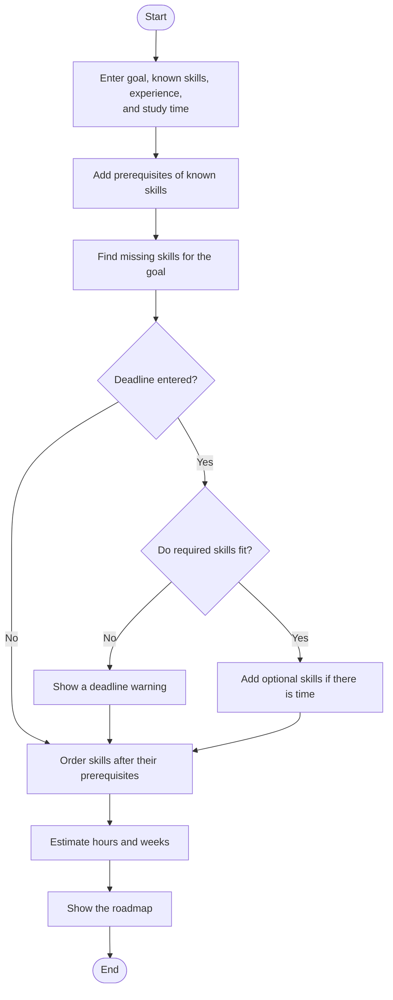

# AI Coding Roadmap Recommender

This program makes a coding study plan based on a learner's career goal,
current skills, experience, and available study time.

## Run the program

Open a terminal in this folder and choose one of these commands:

```bash
python3 main.py
```

This runs the terminal version. It asks questions and prints the roadmap.

```bash
python3 app.py
```

This starts the web version at http://127.0.0.1:8000.

To run the tests:

```bash
python3 -m unittest discover -s tests -v
```

No extra packages are needed. The project uses Python's built-in modules.

## Project files

| File | What it does |
|---|---|
| `skills.py` | Stores the skills, prerequisites, goals, and estimated study hours. |
| `agent.py` | Finds missing skills, orders them, and estimates a schedule. |
| `main.py` | Asks questions and displays a roadmap in the terminal. |
| `app.py` | Shows a form and roadmap in a web browser. |
| `tests/test_agent.py` | Checks that the roadmap planner works as expected. |

## How a roadmap is made


